# GoGUI

A pure-Go, **zero-cgo** declarative GUI toolkit that draws its whole interface with OpenGL — no WebView needed for the UI itself (an optional embedded WebView2 component is available). The visual language follows modern web UI: dark surfaces, rounded corners, gradients, shadows, flex layout, and a fully customizable style DSL.

```
┌──────────────────────────────────────────────┐
│  cmd/gallery                sample apps      │
├──────────────────────────────────────────────┤
│  ui                         declarative tree │
│                             style / layout   │
│                             events / paint   │
├──────────────────────────────────────────────┤
│  internal/gpu               OpenGL 3.3 batch  │
│  internal/text              opentype glyphs  │
│  internal/geom              geometry types   │
│  internal/win32             Win32/WGL bindings│
└──────────────────────────────────────────────┘
```

## Screenshots

Real running screenshots (1180×760, dark theme). Image files live in [`ui/assets/`](ui/assets).

<table>
  <tr>
    <td width="50%" valign="top">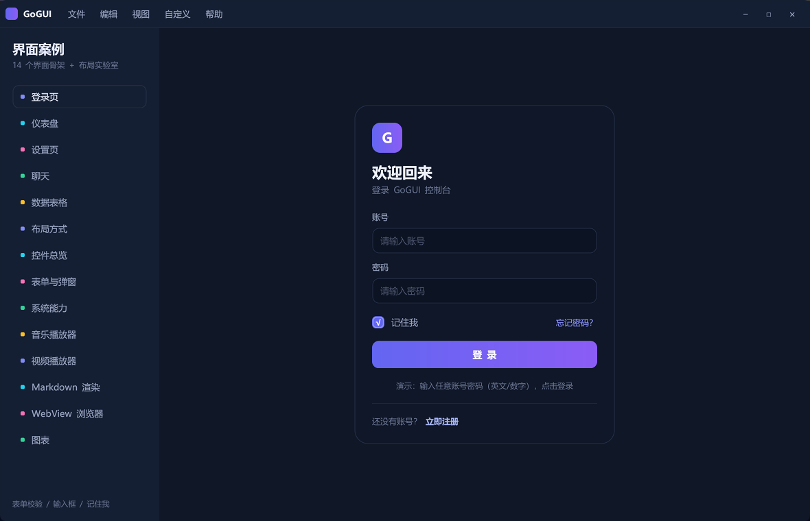<br><sub><b>Login</b> · validation / focus states / remember me</sub></td>
    <td width="50%" valign="top">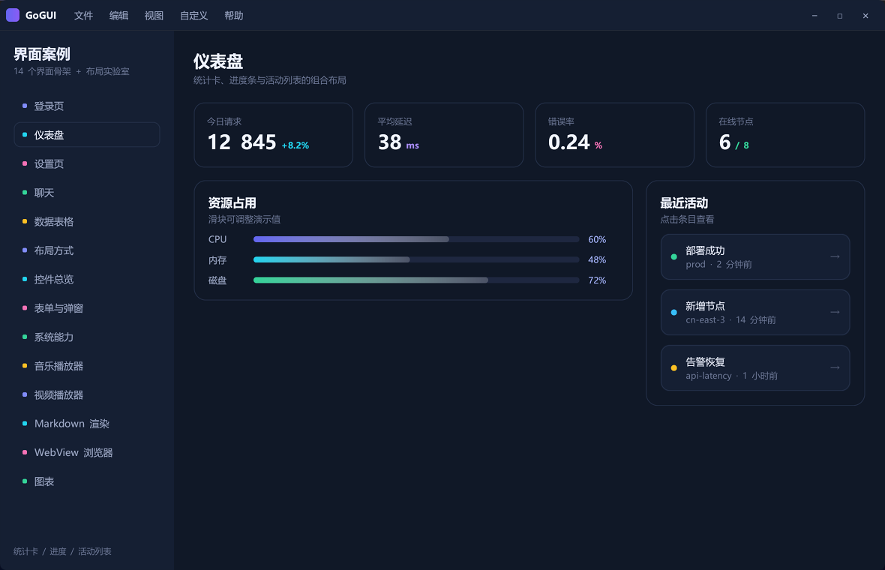<br><sub><b>Dashboard</b> · KPI cards / progress / activity list</sub></td>
  </tr>
  <tr>
    <td width="50%" valign="top">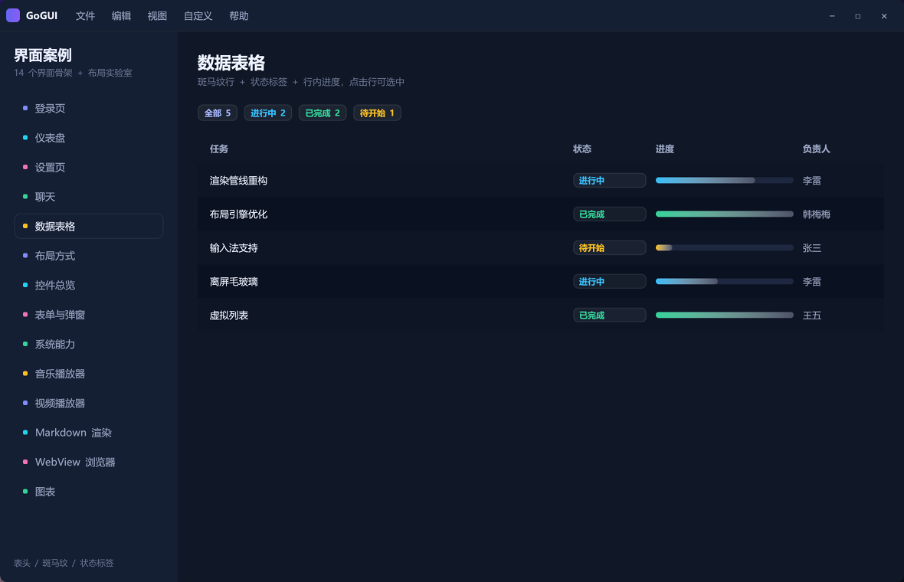<br><sub><b>Data table</b> · zebra rows / status tags / inline progress / row click</sub></td>
    <td width="50%" valign="top">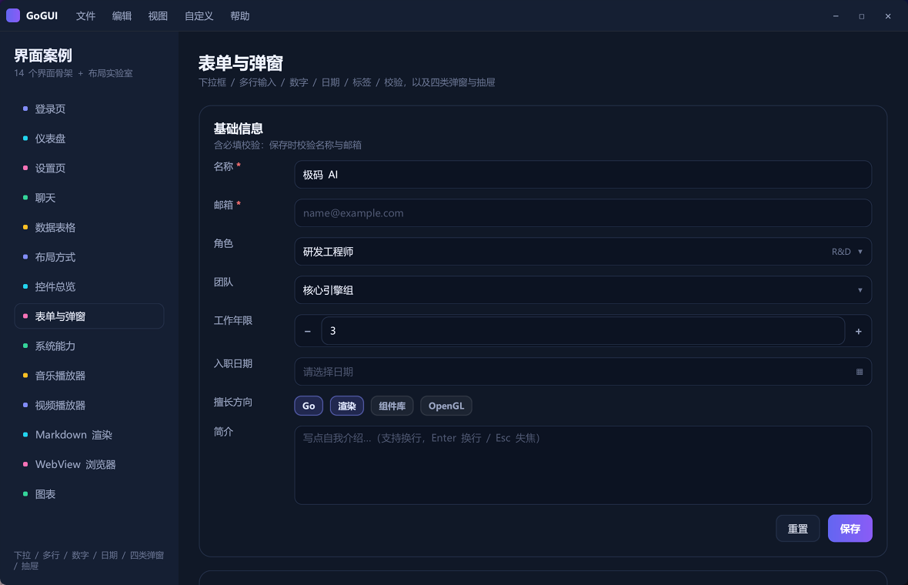<br><sub><b>Form &amp; dialogs</b> · select / textarea / number / date / 4 dialog kinds / drawer</sub></td>
  </tr>
  <tr>
    <td width="50%" valign="top">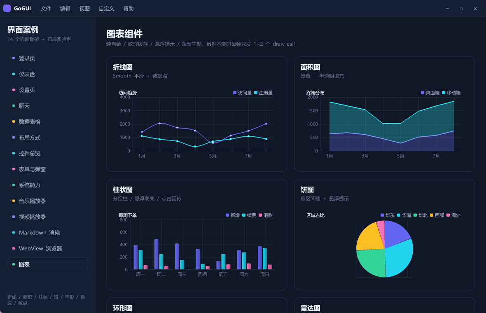<br><sub><b>Charts</b> · line / area / bar / pie / donut / radar / scatter</sub></td>
    <td width="50%" valign="top">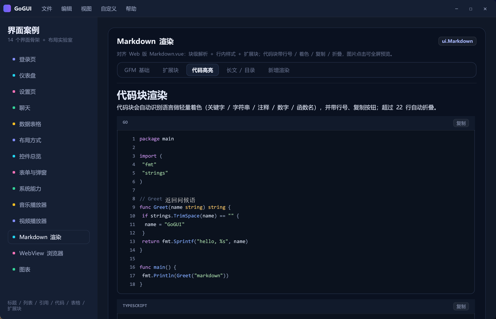<br><sub><b>Markdown</b> · syntax highlight / tables / math / Mermaid</sub></td>
  </tr>
  <tr>
    <td width="50%" valign="top">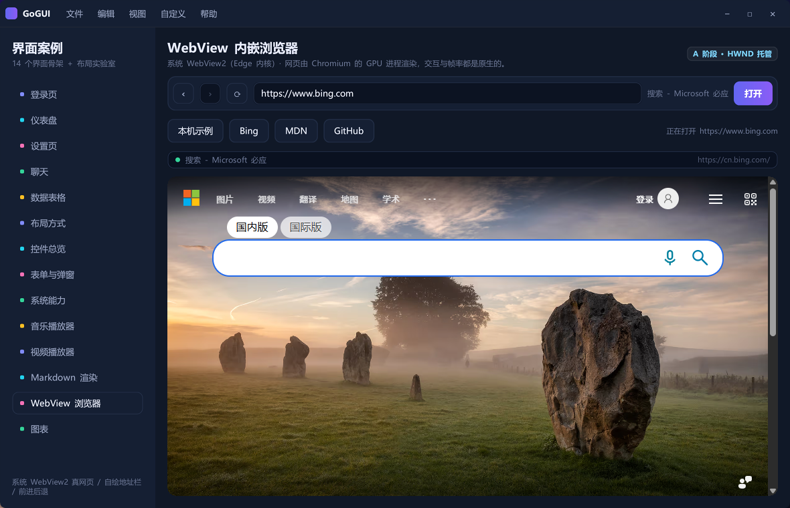<br><sub><b>Embedded browser</b> · system WebView2 page + self-drawn toolbar</sub></td>
    <td width="50%" valign="top">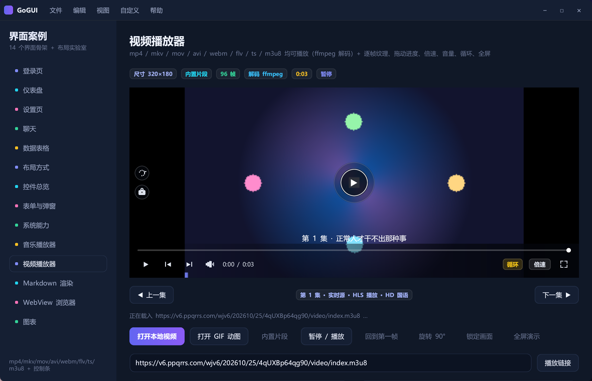<br><sub><b>Video player</b> · mp4/mkv/mov/avi/webm/flv/ts/m3u8 + custom controls</sub></td>
  </tr>
  <tr>
    <td width="50%" valign="top">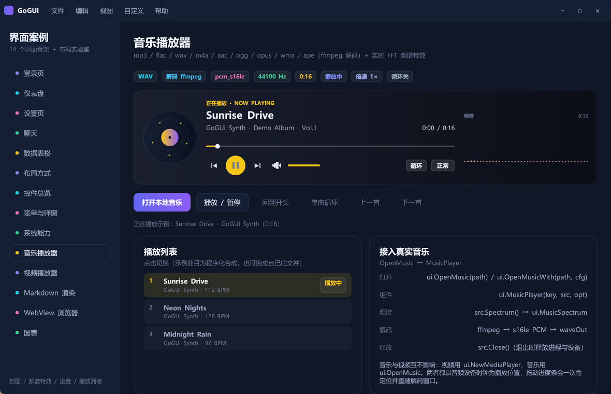<br><sub><b>Music player</b> · cover art / spectrum / seek / playlist</sub></td>
    <td width="50%" valign="top">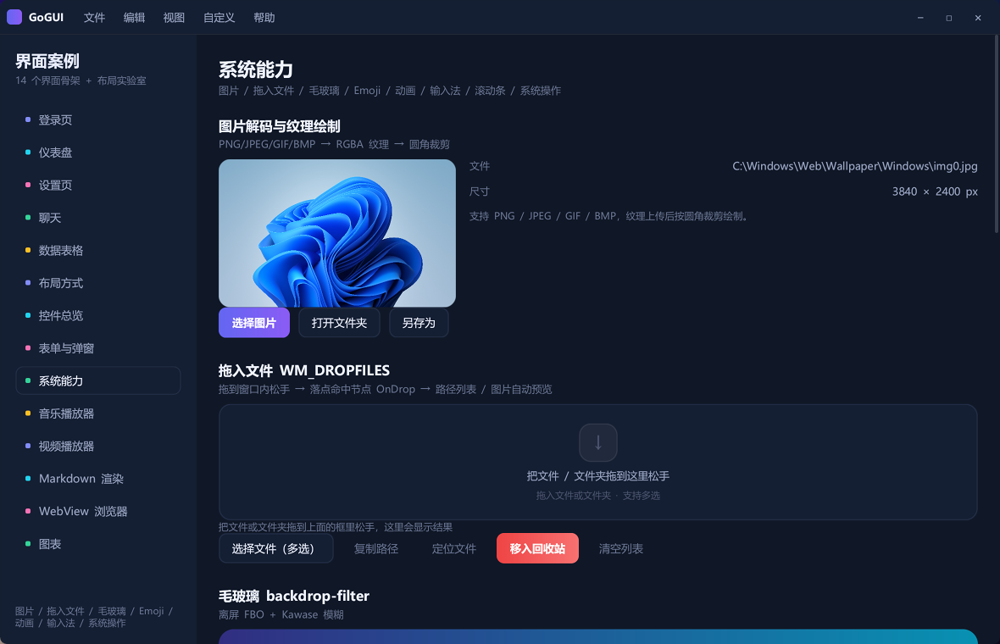<br><sub><b>System features</b> · images / drag-drop / backdrop blur / emoji / IME</sub></td>
  </tr>
  <tr>
    <td width="50%" valign="top">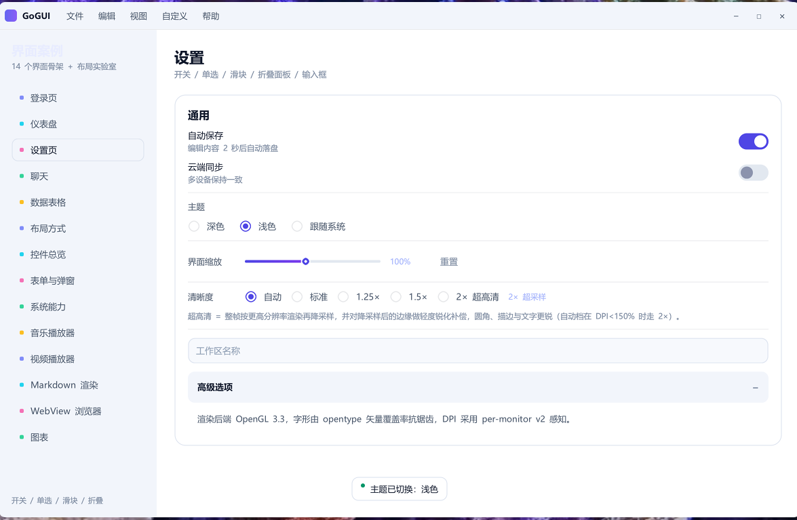<br><sub><b>Light theme</b> · one call to <code>ui.UseTheme(ui.ThemeLight)</code> re-skins widgets and charts</sub></td>
    <td width="50%" valign="top"><i>Everything above is drawn by OpenGL — no HTML, no CSS, no WebView involved in the main rendering path.<br>Run <code>go run ./cmd/gallery</code> to click through every page.</i></td>
  </tr>
</table>

## What's new

Recent work focused on list / content pages and a batch of interaction details:

| Area | Added / fixed |
|---|---|
| List widgets | `FileTree` (indent levels, expand/collapse, selected row; expand state is remembered per `Key` and collapsed subtrees are not built), `MediaCard` (cover / badge / score / title / tags / action button), `ListRows` (icon or avatar, checkbox, dividers, selected row), `PostCard` (community post with likes / comments / shares), `Pager` (ellipsis folding + locked pages) |
| Gallery | The “Lists & Tables” page now uses **in-page underlined tabs**: List (tree / cards / rows / posts / pager) and Table (data table / chat / virtual list / drag-reorder / empty states) |
| Switches | `SwitchEx` with style presets (default / sparkle / labeled / gradient / sizes / disabled) and builders for custom icons, labels and widths |
| Color picker | Hue strip laid out in a row, HEX field width fixed, SVG panel gradient restored; the eyedropper now samples in screen coordinates |
| Gradients | `BgAngle` bakes per-corner colors into vertex colors, so any CSS angle works instead of collapsing to a solid fill |
| Drag | `ReorderList` registers `OnDrag` — the app only creates a drag key when `OnDrag != nil`, so an `OnDragEnd`-only node never sees the release |
| Scrolling | The first wheel event now creates the offset entry, fixing “scrollbar shows but the wheel does nothing until you drag it” |
| Layout | Percentage sizes only resolve when the parent axis is definite; use `Grow(1)` to fill — `Hp(100)` resolves to 0 on an unbounded main axis (the WebView2 blank-page root cause) |
| Windows | The gallery now allows **multiple instances**: every launch gets its own window and page state (`ui.SingleInstance` is still available as a library feature) |

## Why it looks like the web without a browser

| Web feature | Implementation |
|---|---|
| CSS rounded corners / borders | SDF (signed distance field) in the fragment shader, analytically anti-aliased, any radius |
| Linear gradients | Two-color vertex interpolation (`BgGrad`) |
| `box-shadow` | SDF expansion + distance falloff approximating a Gaussian, one draw call |
| Flex layout | Two-pass measure / arrange constraint solver |
| CSS stylesheet | Go chained DSL — type safe, no parsing cost |
| DOM events | Hit testing + bubble to nearest interactive ancestor |
| Text layout | `x/image/font/opentype` coverage rasterization → GPU grayscale atlas (same approach as gio, crisp CJK) |
| HiDPI | Per-monitor DPI v2, everything laid out in logical pixels |

## Quick start

```go
package main

import "gogui/ui"

func main() {
    ui.Run(ui.Options{
        Title:      "My App",
        Width:      1180,
        Height:     760,
        FontFamily: "Microsoft YaHei UI",
        Background: "#070a12",
    }, view)
}

func view() *ui.Node {
    return ui.Column(
        ui.Text("Console").St(ui.St().Text(26, 700, "#eef2ff")),
        ui.Button("New", func() { /* click handler */ }).
            St(ui.St().Text(13, 600, "#fff").PadXY(18, 9).R(10).
                BgGrad("#6366f1", "#8b5cf6", 90).
                Shadow(18, 6, 0, "rgba(99,102,241,0.45)")),
    ).St(ui.St().Padding(28).GapOf(20))
}
```

```bash
go run ./cmd/gallery
# release build without a console window:
go build -ldflags "-H=windowsgui" -o app.exe ./cmd/gallery
```

Requirements: Go 1.24+ (developed on Go 1.26, windows/amd64). No CGO toolchain, no external runtime — Win32, WGL and OpenGL are resolved dynamically through `purego`.

## Ultra-sharp rendering (supersampling)

The renderer supports whole-frame **SSAA**: the frame is drawn into an offscreen target at N× the window resolution and then box-downsampled back, while glyphs are rasterized at the same N× factor. Rounded corners, strokes, shadows and text therefore get N² sub-pixel coverage per output pixel.

```go
ui.SetSuperSample(ui.SSAuto) // auto: 2× below 150% DPI, 1× above
ui.SetSuperSample(ui.SS200)  // force 2×
ui.SetSuperSample(ui.SSOff)  // 1:1, lowest GPU cost
// also: ui.SS125, ui.SS150
```

- Logical layout, hit testing and mouse coordinates are unaffected — only the render resolution changes.
- A pixel budget (8192×4320) automatically steps the factor down (`2× → 1.5× → 1.25× → 1×`) on very large windows.
- Text gamma compensation scales back with the factor so glyphs do not get over-bolded.
- Glyph atlases grow up to 2048² when the raster scale reaches 1.75× or more.

## Building

`build.ps1` pins the release flags (`-trimpath -buildvcs=false`, `-s -w -H windowsgui -buildid=`, `CGO_ENABLED=0`):

```powershell
./build.ps1                 # gallery -> dist\gallery.exe
./build.ps1 -Target all     # gallery + demo + tools
./build.ps1 -Upx            # additionally UPX -9 (smallest)
./build.ps1 -Dev            # dev build: symbols + console log
```

Measured (gallery, go1.26 windows/amd64):

| Build | Size | Notes |
| --- | --- | --- |
| `go build` (default) | 6.45 MB | symbols, debug info, local paths |
| `build.ps1` | **4.54 MB** | −30% |
| `build.ps1 -Upx` | **1.52 MB** | −76%, self-extracting at startup |

## Versioning

The only source of truth is `VERSION.txt` at the repo root (semver `x.y.z`).

```powershell
./build.ps1 -Bump patch        # 0.1.0 -> 0.1.1 (written back to VERSION.txt)
./build.ps1 -Bump minor        # 0.1.0 -> 0.2.0
./build.ps1 -Bump major        # 0.1.0 -> 1.0.0
./build.ps1 -Channel release   # mark the build as release (default: dev)
```

One build injects the version into three places:

| Where | How | Read it |
| --- | --- | --- |
| Runtime | `-ldflags -X gogui/internal/version.Number=...` | `version.String()` / `version.Full()` |
| exe file properties | `tools/winres` generates `cmd/gallery/rsrc_windows_*.syso` | right-click → Properties → Details |
| Installer | `makensis /DVERSION=... /DVI_VERSION=...` | "Apps & features" entry and setup file name |

```go
import "gogui/internal/version"

version.String()   // v0.1.0
version.Title()    // GoGUI v0.1.0 (used as the gallery window title)
version.Full()     // v0.1.0 · release · 1a2b3c4 · 2026-10-29T03:49:04Z
```

`internal/version` also ships the commit hash, build time, release channel, and semver helpers (`version.Parse` / `version.Compare`).

## Installer (NSIS 3)

```powershell
./build.ps1 -Installer                   # -> dist\GoGUI-0.1.0-setup.exe
./build.ps1 -Installer -Upx              # UPX the exe first, then package
./build.ps1 -Installer -Channel release  # release channel
./build.ps1 -Bump patch -Installer       # bump version, then package
```

Requires NSIS 3 (`makensis.exe`). It is auto-detected in `C:\Program Files (x86)\NSIS\` and `C:\Program Files\NSIS\`; otherwise point `NSIS_EXE` at it.

### Install scope (first wizard page)

| Option | Install dir | Registry | Privileges |
| --- | --- | --- | --- |
| Just me (default) | `%LOCALAPPDATA%\Programs\GoGUI` | HKCU | none |
| All users | `%ProgramFiles%\GoGUI` | HKLM | relaunches itself elevated (UAC) |

- An elevated process defaults to "all users", a plain double-click to "just me";
- the directory page accepts any custom path and **it is kept as-is**: switching scope only moves between the two default directories and never overwrites a hand-picked path; each scope remembers its own last directory.

### Silent install / uninstall

```powershell
# install (/D must be the last argument, path must not be quoted)
GoGUI-0.1.0-setup.exe /S /currentuser /D=D:\Apps\GoGUI
GoGUI-0.1.0-setup.exe /S /allusers              # requires elevation, exit code 5 otherwise

# uninstall
"%LOCALAPPDATA%\Programs\GoGUI\uninstall.exe" /S
```

`/currentuser` and `/allusers` skip the scope page, which is handy for scripts and CI.

### What gets installed

| Location | Content |
| --- | --- |
| `$INSTDIR` | `gallery.exe`, `uninstall.exe` |
| Start menu | `GoGUI` shortcut + uninstall entry |
| Desktop | `GoGUI` shortcut |
| Registry | `…\Uninstall\GoGUI`: DisplayName / DisplayVersion / DisplayIcon / Publisher / InstallLocation / EstimatedSize / NoModify / NoRepair |
| Registry | `Software\GoGUI`: InstallDir / Version / Channel / Scope |

- Setup file name, exe properties and `DisplayVersion` all come from `VERSION.txt` — nothing to sync by hand;
- upgrading means running the newer installer over the same scope and directory; old files are replaced and the registered version is updated;
- uninstall kills leftover processes first, then removes the install directory, shortcuts and registry keys (including leftovers from the other scope).

### Pitfalls when editing the script

- `installer/gogui.nsi` contains Chinese text and **must be saved as UTF-8 with BOM**, otherwise makensis fails with `Bad text encoding`;
- never assign `$INSTDIR` inside the install `Section` — it would override the path picked on the directory page; switching scope only calls `SetScope`;
- do not use `InstallDirRegKey`: it stuffs the old directory into `$INSTDIR` before `.onInit`, so an "all users" install would silently reuse the per-user path;
- an exe can only contain one `.rsrc` section, so icons and version info must come from the same `tools/winres` output.

## State and interaction

The component tree is a **pure function rebuilt every frame**. Interaction state lives in your own package-level variables; call `ui.RequestRedraw()` after mutating them (thread-safe):

```go
var current = "dashboard"

ui.Button("Components", func() {
    current = "components"
    ui.RequestRedraw() // next frame: rebuild -> layout -> paint
}).St(ui.St().Text(13, 500, "#8b93ad").PadXY(14, 10).R(10))
```

- Click handlers fire on the **next** frame against the latest tree, so stale node pointers are impossible and `Key` is optional for clicks.
- `hover` / `pressed` visuals are applied automatically for any node with `OnClick != nil`.
- Scroll offsets are stored per node `Key`; give scroll containers a unique `.K("name")`.

## Components

Beyond primitives (`Box/Row/Column/Center/Spacer/Text/Button/Scroll/Stack`), `ui/widgets.go` ships ready-made controls (state held by the caller, call `ui.RequestRedraw()` in callbacks):

| Group | Components |
|---|---|
| Buttons | `Btn` (5 variants), `IconButton`, `Button`, `Link` |
| Forms | `Input`, `PasswordInput`, `Checkbox`, `Radio`, `Switch`, `Slider`, `Progress`, `Ring`, `SelectBox`, `Textarea`, `NumberInput`, `SearchInput`, `Chip`, `DateBox` |
| Display | `Card`, `Title`, `Divider`, `Tag`, `Dot`, `Avatar`, `Badge`, `KeyValue`, `Empty`, `Skeleton`, `Spinner` |
| Navigation | `Tabs`, `TabsBar`, `Breadcrumb`, `Accordion`, `MenuBar` |
| Data | `Table` (fixed/flexible columns, zebra stripes, row clicks), `TableV` (virtual scroll / groups / footer / resizable columns), `VList`, `ReorderList`, `ListItem` |
| Lists & content | `FileTree`, `MediaCard` / `MediaCards`, `ListRows`, `PostCard`, `Pager` |
| Switches | `Switch` plus `SwitchEx` with `SwitchDefault` / `SwitchSparkle` / `SwitchLabeled` / `SwitchGradient` / `SwitchSized` / `SwitchDisabled` presets and custom icon / label builders |
| Media | `Video`, `VideoPlayer`, `Player`, `VideoClip`, `MediaSource` (ffmpeg), `MusicPlayer` |
| Browser | `WebView` (system WebView2) + `WebViewNode` / `WebViewBar` / `WebViewStatus` |
| Overlays | `ModalPanel` / `AlertDlg` / `ConfirmDlg` / `PromptDlg` / `Drawer`, `MenuPanel`, `TooltipOf` + `TooltipLayer`, `Toast`, `Banner` |
| Markdown | `Markdown` with theme-aware syntax highlighting |

Engine capabilities behind them: `Stack` layering, absolute positioning (`AbsFill/AbsTL/AbsTR/AbsBL/AbsBR/AbsCenter/AbsBottom`), focus & keyboard (`FocusOn`, `OnCharEvt/OnKeyEvt`, `ui.SetFocus`), per-frame animation (`AnimOn` + `ui.AnimTime()`, `Tween`/`Spring`/`Keyframes`), coordinate-aware taps (`TapAt`), dragging (`DragEvt`), hover dedup (`OnHoverEvt`), `DisabledOn`, built-in scrollbars, text measuring (`ui.TextWidth`), tooltips (`ui.SetTooltip`).

## Layout

`Row` / `Column` are flex containers, defaulting to `AlignStretch`.

| Method | Meaning |
|---|---|
| `.W(v)` `.H(v)` | fixed size |
| `.Wp(p)` `.Hp(p)` | percentage of parent |
| `.MinWidth` `.MaxWidth` `.MinHeight` `.MaxHeight` | size constraints |
| `.GrowTo(n)` | distribute remaining main-axis space |
| `.Padding(v)` `.PadXY(h,v)` `.PadOnly(t,r,b,l)` | inner spacing |
| `.GapOf(v)` | gap between children |
| `.AlignTo(a)` `.JustifyTo(a)` | cross-axis alignment / main-axis distribution |
| `.Self(a)` | `align-self` override |
| `.Clipped()` | clip overflow |
| `.CenterY` | vertically center text inside its box |

Additional containers: `Grid`, `Wrap`, `Masonry`, `EqualRow`, `EqualCol`, plus responsive helpers `Pick(xs, sm, md, lg)`, `BP(...)`, `ViewportW()` / `ViewportH()`.

## Styling

```go
ui.St().
    Text(15, 600, "#e8ecff").            // size / weight / color
    BgGrad("#1e293b", "#0f172a", 90).    // linear gradient (angle)
    R(14).                               // radius (per-corner via Rx)
    Stroke(1, "#2c3550").                // border
    Shadow(24, 8, 0, "rgba(0,0,0,0.4)")  // blur / offsetY / spread / color
```

Colors accept `#rgb`, `#rrggbb`, `#rrggbbaa`, `rgb()` / `rgba()`, `0xRRGGBB` and `gpu.Paint`. Hover/pressed states are composed by the framework.

Themes: `ui.UseTheme(ui.ThemeDark | ui.ThemeLight | ui.ThemeSystem)` — every token (`ColBg`, `ColText`, `ColStroke`, `ColGlass`, …) follows the active theme, including the Markdown palette and scrollbar color.

## Rendering pipeline

1. `measure` — bottom-up sizing (text measured through opentype)
2. `arrange` — top-down placement and grow distribution
3. paint — shape/text/image vertices are batched; a batch is flushed only on kind or texture change
4. clip — `glScissor` with nested intersection; scroll containers clip automatically
5. optional resolve pass — downsample the supersampled target into the present target

## Project layout

```
gogui/
├── ui/             tree, style, layout, events, theme, widgets, dialogs, media
│   ├── app.go      window, event loop, painting
│   ├── layout.go   measure + arrange, font cache
│   ├── scale.go    UI zoom + supersampling control
│   ├── node.go     declarative nodes and constructors
│   └── style.go    style DSL
├── internal/
│   ├── gpu/        GLSL shaders, batching, textures, clip, blur, resolve
│   ├── text/       opentype rasterization, atlas, metrics, emoji
│   ├── win32/      Win32 + WGL bindings (purego), WebView2, Media Foundation
│   └── geom/       geometry primitives
├── cmd/gallery/    full component gallery (8 category pages, in-page tabs)
└── tools/          fonttest / atlasdump / layouttest
```

## Debugging

```bash
go run ./tools/layouttest      # dump the layout tree (no window)
go run ./tools/fonttest        # print glyph metrics
go run ./tools/atlasdump       # ASCII-dump the glyph atlas
```

Set `ui.Options.DumpLayout = "layout.txt"` to export the first frame's layout tree and exit. `GOGUI_MEMSTATS=1` prints heap/atlas/image statistics every 120 frames; `GOGUI_TEXT_GAMMA` overrides the glyph coverage gamma.

## Performance notes

- Glyph atlases grow on demand (256² → 1024², 2048² at ≥1.75× raster scale), max 24 font instances with LRU eviction.
- Only dirty atlas regions are re-uploaded (`glTexSubImage2D`).
- Font files are memory-mapped, so they never sit on the Go heap.
- Vertex buffers are orphaned + `glBufferSubData` instead of reallocated.
- Repaint on demand: pointer moves only trigger hit testing; minimized windows skip rendering; off-viewport scroll children are culled.
- Images decode asynchronously (4 workers); media frame ring is capped at 48 MB / 2 s.

## Known limitations

- No rich text (inline mixing, image wrapping) or vertical text yet
- Image nodes stretch to their target box (no cover cropping); use same-ratio art or a gradient placeholder for covers
- Video decoding relies on external `ffmpeg` / `ffprobe` (subprocess; high-res software decode is CPU heavy)
- The embedded WebView is HWND-hosted in default mode (A), so web pixels cannot be covered by menus; the experimental DirectComposition mode (B, `GOGUI_COMPOSE=1`) composites them in the same tree

## Platform roadmap

The platform-specific part is `internal/gpu.Backend` plus the window layer; porting does not touch application code.

| Platform | Window | Renderer |
|---|---|---|
| Windows | Win32 (done) | OpenGL 3.3 (done) |
| macOS | Cocoa `NSWindow` + `CAMetalLayer` | Metal / OpenGL 4.1 |
| Linux | X11 / Wayland | OpenGL / Vulkan |
| Android | `ANativeWindow` + EGL | GLES 3 |
| Web | `canvas` (mouse / keyboard / wheel events) | WebGL 2 + WebAssembly (done) |

## License

MIT — see [LICENSE](LICENSE).
